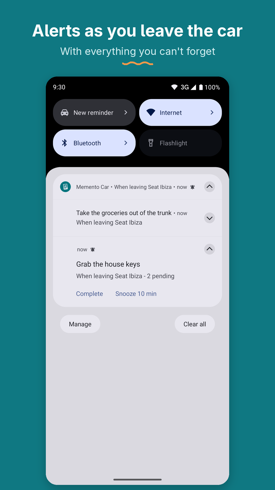
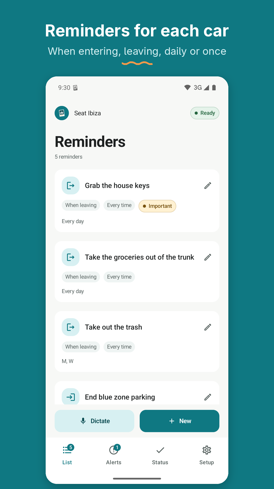
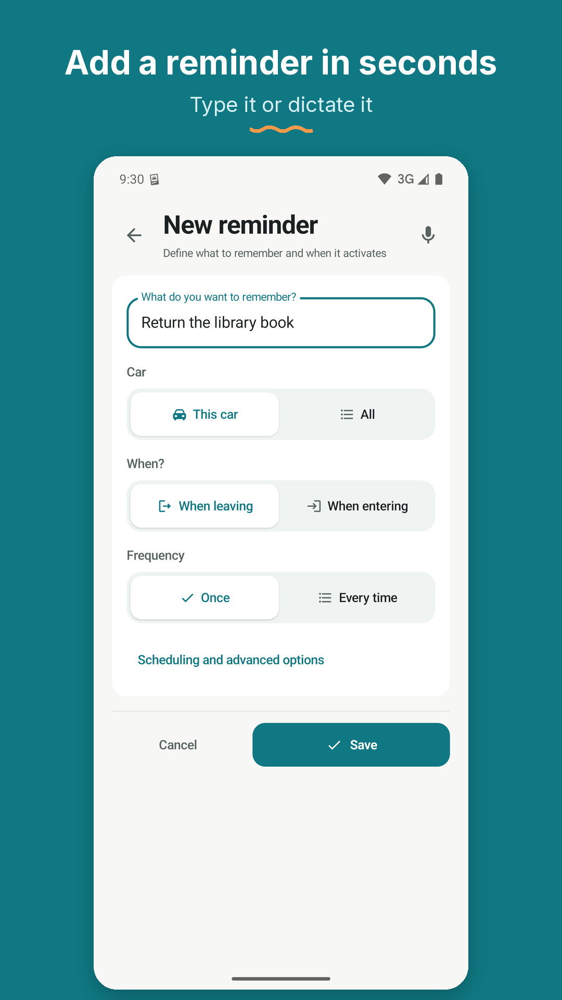

<p align="center">
  
</p>

<h1 align="center">Memento Car</h1>

<p align="center">
  Reminders that show up when you get in or out of your car.<br>
  An Android app triggered by your car's Bluetooth.
</p>

<p align="center">
  <strong>Android 8.0+</strong> &nbsp;·&nbsp; <strong>English, Spanish and Catalan</strong> &nbsp;·&nbsp; <strong>No accounts, no ads</strong>
</p>

<p align="center">
  <a href="https://play.google.com/store/apps/details?id=io.nodetech.mementocar"><b>Get it on Google Play</b></a>
  &nbsp;·&nbsp; <a href="#features">Features</a>
  &nbsp;·&nbsp; <a href="#privacy">Privacy</a>
  &nbsp;·&nbsp; <a href="#build">Build</a>
</p>

<p align="center">
  <a href="https://github.com/nodetech-io/mementocar/actions/workflows/ci.yml"></a>
  <a href="LICENSE"></a>
</p>

---

Memento Car detects when your phone connects to or disconnects from your car's Bluetooth and shows the reminders you set for that moment: the house keys, the groceries in the trunk, the parking ticket... All features are free. You need a car with Bluetooth paired to the phone.

<p align="center">
  
  
  
</p>

## Features

- **Per car, on entering or leaving.** Reminders are triggered by the car's Bluetooth link. Partial audio-profile changes do not trigger them.
- **Once or every time.** On selected days of the week, with an optional notification delay.
- **Important reminders** repeat until you complete or snooze them.
- **Hands-free voice input** in English, Spanish and Catalan, with a Quick Settings tile. See [voice commands](docs/voice-commands.md).
- **A Status tab** that checks permissions, Bluetooth and the latest alert, and sends a test alert.
- **Backups** you export and import as a file.

## Privacy

Cars and reminders are stored on the device. The app has no INTERNET permission, no account, no ads, no analytics and no developer-owned server. Optional voice features use the device's speech services, which may process audio or text online. See the [privacy policy](https://nodetech.io/mementocar/privacy/) (source in [docs/privacy](docs/privacy/)).

| Permission | Use |
| --- | --- |
| `BLUETOOTH_CONNECT` (`BLUETOOTH` and `BLUETOOTH_ADMIN` up to Android 11) | List paired devices and receive the car's connect and disconnect events |
| `RECORD_AUDIO` | Optional voice input |
| `POST_NOTIFICATIONS` | Reminder notifications |
| `RECEIVE_BOOT_COMPLETED` | Restore pending alarms after a reboot |

App data is excluded from Android automatic backup and device transfer. Manual backups are files you export and keep yourself.

## Build

Open the project in Android Studio, or run Gradle with JDK 17 or later and an Android SDK that has API 37 installed. Gradle runs its daemon on JetBrains JDK 21, which it downloads automatically the first time (see `gradle/gradle-daemon-jvm.properties`). The app itself targets Java 17.

```sh
./gradlew testDebugUnitTest
```

Debug builds use the application ID `io.nodetech.mementocar.debug`, so they can be installed next to the Google Play version.

## Release

See [building and validating a release](docs/release.md): signing, tests for both variants, 16 KB page size checks and a language pass. Changes are listed in [CHANGELOG.md](CHANGELOG.md). Store texts, release notes and graphics are in [fastlane/metadata/android](fastlane/metadata/android/), in the layout F-Droid and fastlane read (see [docs/store](docs/store/)).

## License

Copyright © 2026 Prodlabs22, S.L. (Nodetech). Memento Car is free software under the [GNU General Public License v3.0 or later](LICENSE). This covers every file in the repository, including icons and store graphics, unless a file states otherwise; third-party components such as the Gradle wrapper scripts keep their own licenses.

## Forks

Before distributing a modified build:

- Use a different name and icon, and do not suggest the build comes from Nodetech. The license does not grant rights to the “Memento Car” name or logo (GPLv3 §7(c) and §7(e)).
- Change `applicationId` in `app/build.gradle.kts` (currently `io.nodetech.mementocar`). The `namespace` and Kotlin packages can stay as they are.
- Replace the app name (`app_name` and the other strings that mention “Memento Car” in `app/src/main/res/values*/strings.xml`) and the icon drawables (`memento_car_icon_*`, `ic_launcher_monochrome`, `ic_notification_*`).
- Replace the source code (`SOURCE_CODE_URL`), privacy policy and “Created by Nodetech” links in `app/src/main/java/io/nodetech/mementocar/ui/MementoCarApp.kt` with your own. The Nodetech privacy policy only covers the official build.
- Use your own signing key. See [signing](docs/release.md#1-signing).

## Contributing

See [CONTRIBUTING.md](CONTRIBUTING.md). To report a security issue, follow [SECURITY.md](SECURITY.md) instead of opening a public issue.
